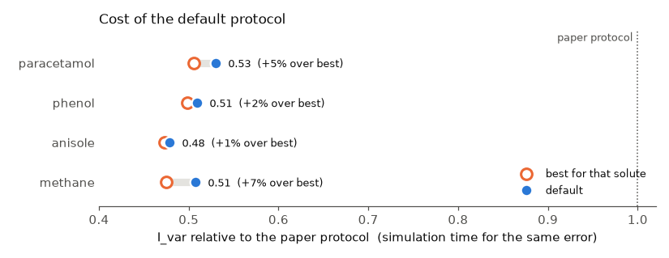
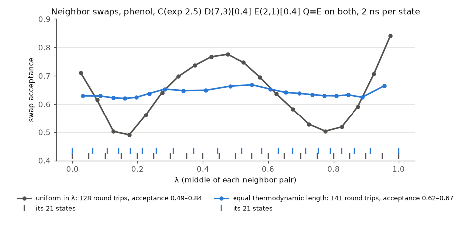
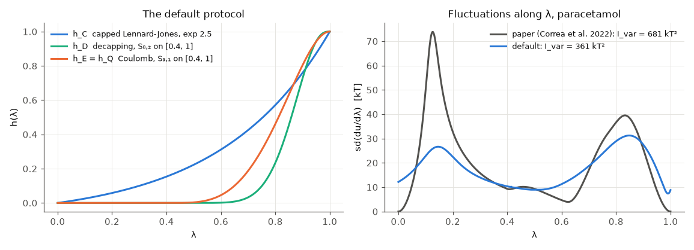
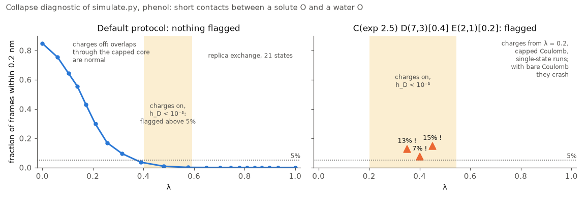

# LBF protocol optimization

Scripts to compute the hydration free energy of a small molecule with a linear basis function (LBF)
alchemical protocol, and to choose that protocol's switching functions, using `SlicedNonbondedForce` with
Lennard-Jones and Coulomb decapping. They sample a set of states by replica exchange, score whole families
of protocols by MBAR reweighting of those samples, and place the states of the next round. They are meant
to be read and adapted, not used as a library.

## Requirements

- OpenMM and this plugin built with Coulomb decapping, that is, with `addScalingParameter` taking seven
  arguments (currently the `coulomb-decapping` branch; see the plugin's README to build it). An older build
  is refused with a message saying so. The capped potentials and decapping are described in
  [the plugin's guide](../../docs/guide/decapping.md).
- `openff-toolkit` and `openmmforcefields`, with a backend for AM1-BCC charges (AmberTools, OpenEye or
  `openff-nagl`).
- `pymbar` 4 and `scipy`. pymbar runs on JAX, which the scripts keep on the CPU.
- A CUDA GPU for `simulate.py` by default (`--platform OpenCL`, or `CPU` at much lower speed, otherwise).
- Optionally `matplotlib` for the `--plot` options, and `pytest` for the tests
  (`python -m pytest test_lbf.py`).

## Quick start

The default protocol, `C(exp 2.5) D(8,2)[0.4] E(3,1)[0.4] Q=E`, was chosen for phenol, methane, anisole and
paracetamol. It needs about half the simulation time of the protocol of Correa et al. for the same error,
and for each solute it is within 7% of the best protocol found for that solute alone (`RESULTS.md`):



For a solute like these, sample it and compute its hydration free energy:

```bash
python simulate.py run1 --smiles "CC(=O)Nc1ccc(O)cc1"    # 21 states uniform in λ, 2 ns each, one GPU
python free_energy.py paracetamol=run1                    # ΔG in kT, kJ/mol and kcal/mol
```

At the end, `simulate.py` prints the collapse diagnostic (see [Charging too early](#charging-too-early)).
No state should be flagged. If one is, or a replica crashes in a state where the charges are on and
h_D < 10⁻³, the protocol charges too early for this solute: start the electrostatics later, for example
with `--protocol "C(exp 2.5) D(8,2)[0.4] E(3,1)[0.5] Q=E"`, or search for a protocol with a lower
`--max_hazard`.

States placed at equal thermodynamic length make neighbor exchanges even and replicas travel faster. To
place them from the first run and sample again:

```bash
python search.py run1 --choose default --next plan.json   # also scores the protocol family
python simulate.py run2 --plan plan.json                  # the plan carries the protocol, states and system
python free_energy.py paracetamol=run1,run2               # ΔG of each run and their mean
```



## The protocol

Four solute-solvent terms of a `SlicedNonbondedForce` are scaled by functions of one coupling parameter
λ ∈ [0, 1] (Correa et al., *J. Chem. Theory Comput.* 18, 5876, 2022):

| term | scales | global parameter |
|------|--------|------------------|
| C | capped Lennard-Jones | `lambdaLJ` |
| D | Lennard-Jones decapping | `lambdaD` |
| Q | Coulomb decapping | `lambdaQD` |
| E | electrostatics (Coulomb, capped below σ) | `lambdaQ` |

A capped potential is the Lennard-Jones or Coulomb potential with its core replaced by a finite cap, so
that solvent can overlap a weakly coupled solute without a singularity; decapping restores the core. The
energy is linear in the four parameters, U = U_rest + h_C U_C + h_D U_D + h_Q U_Q + h_E U_E, and the
plugin computes the four slice energies along with the energy. So the reduced potential of any state is
known from the four slice energies of each sample. Replica exchange gets the energies of every replica in
every state from one evaluation, and the search can reweight the samples to any protocol.

The two decapping terms tell the electrostatic schemes apart. With h_Q = h_E, the charges switch on the
bare Coulomb potential, as in Correa et al.; this is the family searched here. With h_Q = h_D, the Coulomb
potential stays capped until the Lennard-Jones core is decapped. Both are protocols of the same basis, so
samples of either reweight to the other.

Each term follows S_{m0,m1}(x) = x^(m0+1) P(x), the polynomial step whose first m0 derivatives vanish at
x = 0 and first m1 derivatives at x = 1, or the exponential (e^(bx) − 1)/(e^b − 1). Written as text, a
protocol is, e.g.,

    C(exp 2.5) D(8,2)[0.4] E(3,1)[0.4] Q=E

that is, h_C the exponential with rate 2.5, h_D zero up to a = 0.4 and S_{8,2} over [0.4, 1], h_E S_{3,1}
over the same window, and the Coulomb decapping tied to E. Q follows D unless the text says `Q=E` or gives
it a switching function of its own, `Q(7,2)[0.4]`. `D(inf)[0.4]` is a C∞ step, `paper` is the windowed
S_{2,2} protocol of Correa et al., with bare Coulomb, and `default` is the default protocol.

The exponential is the family for C. Every polynomial step has a zero slope at one end or both, and with
any of them sd(du/dλ) keeps a peak where the cavity grows, at small λ; the exponential, whose slope is finite
at both ends, flattens it. The price is a finite λ-force at λ = 0 and 1, which is what makes the variance
finite there; whether λ-dynamics minds is still to be tested.



The decapping window keeps h_D, and the λ-force of decapping, exactly zero while the capped terms are weak.
Where decapping starts, solvent still overlaps the capped core now and then, and the decapping energy of
such a configuration is large; du/dλ weights it by dh_D/dλ ∝ x^m0, so the onset power m0 + 1 must be high
for var(du/dλ) to stay finite there. The searches keep m0 + 1 ≥ 8. The electrostatics have a window too,
by default the same one.

## Charging too early

A water hydrogen has no Lennard-Jones sphere, so only the capped O–O repulsion holds it off a solute
acceptor while the core is capped. With bare Coulomb the attraction is unbounded at contact: a protocol
that charges while h_D is still essentially zero pulls a water onto the solute, and the simulation either
crashes with NaN coordinates or holds a fused water (O–Ow ≈ 1 Å).

The rule is a bound on the **charging hazard**, max h_E/h_C wherever h_D < 10⁻³. `search.py` keeps only
protocols with a hazard of at most 0.15 (`--max_hazard`); the default has 0.13. For phenol, a hazard of 0.5
or more collapses within nanoseconds, and above 0.15 reweighting showed the fused water favorable between
the sampled states (`RESULTS.md`).

`simulate.py` checks it on configurations. Per frame it records the closest approach of a solute N or O
(every solute heavy atom if it has neither, as for methane) to a water oxygen. At the end it prints, per
state, the fraction of frames within 0.2 nm, and it marks with `!` the states where that fraction exceeds
5% while the charges are on and h_D < 10⁻³. With the charges off, short contacts are normal, since water
passes through the capped core: near λ = 0 most frames have one. With the charges on and h_D < 10⁻³,
protocols under the limit show 0 to 1.5% for phenol, and one that charges early (with capped Coulomb, so
that it does not crash) 7 to 15%. A crash in such a state is reported with its likely cause.



## Files

| file | what it does |
|------|--------------|
| `lbf.py` | switching functions, `Protocol`, the default protocol, state placement, the replica-exchange move, the system builder, the run loader |
| `simulate.py` | replica exchange of λ among the states of a protocol → `samples.npz` |
| `free_energy.py` | the hydration free energy of one or more runs, and its spread over independent runs |
| `search.py` | pools runs of one system, solves MBAR, scores the protocol family under the hazard limit → ranked table, `results.npz` and the next round's plan |
| `compare_solutes.py` | ranks the protocols that several solutes' searches explored by how far each is from every solute's own best |
| `flow.py` | the replica flow of a run, and the feedback-optimized states next to the equal-length ones |
| `reparametrize.py` | λ(c) in closed form for a protocol, c the thermodynamic length, for λ-dynamics with a flat target |
| `test_lbf.py` | unit tests |
| `RESULTS.md` | how the default protocol was chosen, and the procedure to repeat it |

Every script lists its options and their defaults with `--help`.

## Running `simulate.py`

The system is the solute (`--smiles`, required), its force field (`--forcefield`, a SMIRNOFF or GAFF name,
default `openff-2.2.1` with AM1-BCC charges), the water (`--water`, an OpenMM force field file for a 3-site
model, default TIP3P; 4- and 5-site models are not supported), the box, hydrogen mass, temperature,
pressure, and the capping orders. `--capping_orders M0 M1` sets the height of the cap: (3, 3), the
default, caps the Lennard-Jones potential at 119 ε, (2, 4) at 684 ε. A run stores all of these, the plan
that `search.py --next` writes carries them, and `simulate.py --plan` uses them; an option given with
`--plan` must agree with the plan, and `--protocol`, `--lambdas` and `--nstates` cannot be given with it.
`search.py` pools only runs that agree on all of them.

Each replica has its own `Context`, so an exchange only swaps the global parameters of two Contexts. After
every iteration (1 ps by default), `--swap_attempts` random pairs of replicas, K³ by default, are swapped
with the Metropolis criterion. Each attempt leaves the distribution of state permutations invariant, and
enough attempts approach drawing a new permutation from it (Chodera and Shirts, *J. Chem. Phys.* 135,
194110, 2011). With only nearby states swapping, the labels move like a shuffle by neighbor transpositions,
which needs about K³ attempts to forget the starting order. They take about 10 ms per iteration for
K = 21. `--no_exchange` keeps every replica in its state, and with `--lambdas` a single state can be
tested alone, cheaply (about 0.05 s per ps), for instance to check a protocol's weakly coupled states for
collapse. `free_energy.py` and `search.py` need states at λ = 0 and 1 among the runs they read.

`samples.npz` stores, per iteration, the state of each replica, its slice energies and the closest contact,
including the `--equilibration` iterations, which the other scripts skip. `checkpoint.npz` is written with
it every `--checkpoint_interval` iterations. Rerunning the same command resumes from it, and rerunning it
with a larger `--iterations` extends the run; a change of protocol, states, system or sampling settings is
refused. If a replica fails, the error names its state and λ.

## Searching for a solute's own protocol

The default protocol makes the search optional. A search is worth running for a solute unlike the four
above, a different force field, or a different family:

```bash
# 1. sample the default (or another seed that satisfies the hazard limit)
python simulate.py run0 --smiles "c1ccc(cc1)O"

# 2. score the family against everything sampled so far, one search per window start a
python search.py run0 --a 0.3 --out phenol_a03.npz
python search.py run0 --a 0.4 --out phenol_a04.npz --next next.json

# 3. sample the best protocol at the states the plan places, and score again with both runs
python simulate.py run1 --plan next.json
python search.py run0 run1 --a 0.4 --out phenol_a04.npz
```

The family is set by options of `search.py`: the rates of the exponential C (`--bC`), the orders of D and
E (`--m0D`, `--m1D`, `--m0E`, `--m1E`), the window starts (`--a`, and `--aE` ≥ a for E), and the scheme
(`--Q`). The window start is a fixed choice per search, not a searched variable. The paper protocol, the
default and any `--reference` are scored for comparison, and `--next` writes the plan for the best
explored protocol, or for `--choose`.

To find one protocol for several solutes, give `compare_solutes.py` each solute's results files:

```bash
python compare_solutes.py phenol=phenol_a03.npz,phenol_a04.npz methane=methane_a03.npz,methane_a04.npz
```

It ranks the protocols explored for every solute by the largest and by the mean ratio of their I_var to
each solute's own best, and prints those ratios for the default (or `--show` other protocols).

### Scores

At each λ, MBAR reweighting gives the mean and variance of du/dλ, and the search integrates:

- I_var = ∫ var(du/dλ) dλ, the cost with uniformly spaced states, and the relevant measure when λ is
  sampled uniformly, as in λ-dynamics with a flat target. This is the default ranking.
- L = ∫ sd(du/dλ) dλ, the thermodynamic length. It is the cost of a protocol whose states are spaced at
  equal increments of length, which is how `--next` places them (`--rank L`).
- I_var/L² ≥ 1, which is 1 when sd(du/dλ) is flat: how much a protocol depends on the spacing of its states.

Every protocol must integrate to the same ΔG, which checks the quadrature. A protocol counts as explored
when the Kish effective sample size is at least `--ess` at every node; protocols far from the sampled
states are not trusted. `--min_hC_at_a 0.1` keeps only protocols whose capped Lennard-Jones is already
that strong where decapping starts.

### Placing the states

Equal increments of thermodynamic length place the states by the overlap of neighbors, from the
reweighted variance alone. The feedback optimization of Katzgraber, Trebst, Huse and Troyer (*J. Stat.
Mech.* P03018, 2006) places them by the dynamics instead: with each replica labeled by the end state it
visited last, the fraction f(λ) of up-walkers falls from 1 to 0, and the rate of round trips is largest
when the density of states is proportional to √(−df/dλ). `flow.py RUN` measures f from a run's replica
history, counts round trips, and prints both allocations. For phenol they agree to within the noise of f,
so the simpler equal-length placement is the one used, and the flow is the check.

### The protocol in the thermodynamic-length coordinate

For λ-dynamics with a flat target, the coordinate to sample is c(λ) = ∫₀^λ sd(du/dλ′) dλ′ / L, along which
sd(du/dc) = L everywhere; the equal-length states are its uniform grid. `reparametrize.py RUN` gives λ(c)
for the default protocol (or `--protocol`) in closed form: the ends of the exact map are singular,
λ ∝ c^(1/(p0+1)) and 1 − λ ∝ (1 − c)^(1/(p1+1)) with (p0, p1) the end orders of the protocol, so
λ(c) = (1 − (1 − w(c))^(1/(p1+1)))^(1/(p0+1)) with a nondecreasing Bernstein polynomial w, whose
coefficients are chosen to flatten sd(du/dc). The switching functions in c are the exact h(λ(c)), so they
keep their bounds, windows and onset powers. With the exponential C, I_var/L² is already near 1 in λ, so
the map gains little.
